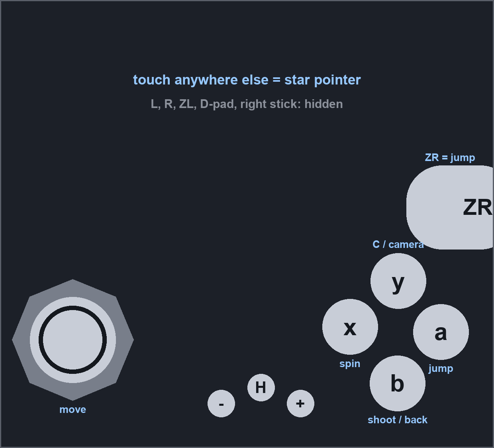

# Super Mario Galaxy 2 - full-screen preset for Dolphin (any screen shape)

Makes Super Mario Galaxy 2 fill your whole screen with correct proportions in Dolphin, plus
a setup that runs it cleanly at 60 FPS on a Snapdragon 8 Elite Gen 5 phone.

- **3D:** a patch scales the game's gameplay-camera projection to your screen. On a screen
  narrower than 16:9 (foldables, 4:3, 16:10) you keep the stock 16:9 left-right view and get
  extra view above and below (Vert+). On a wider screen (21:9, 32:9, 20:9 phones) you get extra
  view at the sides (Hor+). Nothing is cropped or zoomed, storybook scenes keep their text, and
  the star pointer still lines up.
- **UI:** a second patch sets the game's own layout scale, so text and HUD keep their shape and
  nothing is cut off. On a narrow screen the UI sits in a centered 16:9 band; on a wide screen
  it spreads to the sides.
- **Save states work:** both are Dolphin patches, re-applied every frame, so they hold after
  loading any save state.
- **Classic Controller:** includes the Classic Controller patch from
  [Galaxy-2-Patch](https://github.com/Wii-Patches/Galaxy-2-Patch) by quatric, so with Dolphin's
  emulated Wii Remote + Classic Controller every action is a button (spin on x, no shaking) and
  the touchscreen overlay shows a full controller. The star pointer stays on the touchscreen.
- **Star pointer exactly under your finger:** a third patch turns off the game's pointer
  smoothing, and the profiles carry calibrated IR settings, so the touch pointer lands where you
  touch instead of trailing behind or overshooting toward the edges.
- **Controls (optional):** gamepad profiles (Classic Controller, or Wii Remote + Nunchuk with the
  star pointer on the touchscreen, phone tilt or the right stick) and a tested touch layout.

| | |
|---|---|
| Game | Super Mario Galaxy 2, **USA (SB4E01) only** - other regions use different addresses |
| Emulator | Dolphin **2609-83** official dev build (Android) or newer. The 2609a release is **not** enough on Adreno 8xx GPUs (see Requirements) |
| Tested device | OPPO Find N6 (CPH2765), Snapdragon 8 Elite Gen 5 (SM8850), **Adreno 840**, Qualcomm driver V@0842.44 (May 2026), Android 16 / ColorOS |
| Tested screen | **2480x2248** (Find N6 inner screen, landscape, 1.10:1, Vert+): gameplay, menus, HUD, star pointer, opening narration, framed storybook scenes. Hor+ (wide screens) is generated by the same script but **not tested in-game yet** |
| Result | 60 FPS / 100% speed at 2x internal resolution, no flicker, full-screen 3D and UI |

## Requirements

1. **Dolphin 2609-83 or newer** (official dev build from
   [dolphin-emu.org/download](https://dolphin-emu.org/download/), "Development versions").
   It contains [PR #14899](https://github.com/dolphin-emu/dolphin/pull/14899), a workaround for
   an Adreno 8xx driver bug that renders wrong colors and flickers. Dev builds are signed
   with the same key as the releases, so they install over an existing Dolphin and keep your
   settings and saves.
2. Your own copy of Super Mario Galaxy 2 (USA), any format Dolphin reads (RVZ/ISO/WBFS).

## Quick install (OPPO Find N6, or any 2480x2248 screen)

Dolphin's user folder on Android is `Android/data/org.dolphinemu.dolphinemu/files/`
(on a PC it is Dolphin's `User` folder).

1. Copy `SB4E01.ini` into `files/GameSettings/` (overwrite if it exists).
2. Copy the `Profiles` folder into `files/Config/` (you get four files in
   `files/Config/Profiles/Wiimote/`).
3. Start the game. Save states made before or after installing both work.

The UI scale is applied when the game creates a menu or HUD element, so a save state made
mid-scene keeps that scene's UI as it was when saved; anything opened after loading is correct.

For a gamepad, also:

4. Dolphin > Settings > Wii Input > Wii Remote 1 > gear icon > **Profile** > load one of:
   - `Gamepad - Classic Controller` - Wii Remote + Classic Controller: spin on a button, star
     pointer by touching the screen, full touch overlay when no gamepad is connected (the tested
     favourite, see [Classic Controller](#classic-controller-spin-on-a-button))
   - `Gamepad - Touch Pointer` - Wii Remote + Nunchuk, star pointer by touching or dragging on
     the screen
   - `Gamepad - Phone Tilt Pointer` - star pointer follows the phone's angle
   - `Gamepad - Right Stick Pointer` - star pointer on the right stick
5. Touch pointer: keep the touch overlay **on** (the pointer only works while it is shown). With
   a gamepad you can untick its buttons (in-game Back > Overlay Controls > Toggle Controls). For
   the tilt and right-stick profiles you can hide the overlay with **Toggle All**.

### Classic Controller (spin on a button)

Super Mario Galaxy 2 only accepts a Wii Remote + Nunchuk, and spins are a shake. The preset
includes the Classic Controller patch from [Galaxy-2-Patch](https://github.com/Wii-Patches/Galaxy-2-Patch)
(quatric, MIT; the version is pinned in `src/third_party/galaxy2patch/`), turned into Dolphin
patches, so you can use Dolphin's **emulated Wii Remote + Classic Controller** instead. It also
changes the on-screen prompts from shake icons to buttons. With a Nunchuk attached the patch does
nothing, so the Nunchuk profiles still work.

The star pointer stays on the touchscreen: the patch's own right-stick pointer is a separate patch
that is off by default (`--classic-stick-pointer` turns it on, or enable "Classic Controller
right-stick pointer" in Edit Game Settings > Patches).

| Action | Classic Controller (touch overlay) | DualShock 4 (`Gamepad - Classic Controller`) |
|---|---|---|
| Move | Left stick | Left stick |
| Jump | a or ZR | Cross |
| Spin | **x** | Square or R1 |
| Shoot star bits / back | b or R | R2 or Circle |
| Crouch / ground pound / long jump | ZL | L2 |
| Center camera (C) | y or L | L1 or Triangle |
| Camera adjust | D-pad | D-pad |
| Pause / - / HOME | + / - / HOME | Options / Share / PS |
| Star pointer | touch the screen | touch the screen |

**Tested touch layout** (2480x2248, overlay scale default): only the left stick, a/b/x/y, ZR and
-/HOME/+ are shown.



To set it up: in-game Back > Overlay Controls > **Toggle Controls**, untick L, R, ZL, D-Pad and
Right Stick; then **Edit Layout** and drag the buttons to match. Dolphin stores button positions
in its private app data, so they can't be shipped as a file; the picture is the reference
(approximate centers in pixels on the 2480x2248 screen: x 1758,1640 - y 2000,1410 - a 2213,1665 -
b 1996,1923 - ZR's left edge at 2040, top at 830 - left stick 365,1705 - minus 1110,2025 -
HOME 1310,1945 - plus 1508,2025). The toggles are in `files/Config/Dolphin.ini`:

```
[AndroidOverlayButtons]
ButtonToggleClassicTriggerL = False
ButtonToggleClassicTriggerR = False
ButtonToggleClassicButtonZL = False
ButtonToggleClassicDPad = False
ButtonToggleClassicStickRight = False
```

### Android 16 foldables/tablets: keep Dolphin in landscape

Dolphin already asks for landscape, but Android 16 ignores orientation requests on large
screens (an unfolded Find N6 counts), so the game rotates with the phone. To make Android
honour Dolphin's landscape lock for Dolphin only (other apps keep rotating), run once from a
computer with adb:

```
adb shell am compat disable UNIVERSAL_RESIZABLE_BY_DEFAULT org.dolphinemu.dolphinemu
```

This closes Dolphin if it is open. It may need to be run again after Dolphin is updated.

## Other screens (configuration)

Both patches depend on your screen shape, so make a preset for your screen with
`src/make_preset.py` (Python 3, no extra packages):

```
python3 SuperMarioGalaxy2/src/make_preset.py --width 2400 --height 1080 --out SB4E01.ini
python3 SuperMarioGalaxy2/src/make_preset.py --aspect 16:10 --out SB4E01.ini
python3 SuperMarioGalaxy2/src/make_preset.py --from-adb --out SB4E01.ini     # reads the connected phone
```

Options: `--stock-pointer` keeps the game's star-pointer smoothing (without it the star stops a
little short of where it is aimed, which you notice with a touch pointer), `--show-fps` adds Dolphin's FPS/speed counters, `--wiimote-profile "Gamepad - Classic
Controller"` makes the game load that controller profile automatically, `--classic-stick-pointer`
puts the Classic Controller's star pointer on the right stick, `--no-classic` leaves the Classic
Controller patch out. Use the screen you
actually play on in landscape (on a foldable, the screen that is open).

| Screen | Mode | Camera | UI scale | Tested in-game |
|---|---|---|---|---|
| 2480x2248 (OPPO Find N6 inner) | Vert+ | vertical x 0.6206 | y 0.6206 | Yes |
| 4:3 | Vert+ | vertical x 0.75 | y 0.75 | No |
| 16:10 (tablets) | Vert+ | vertical x 0.9 | y 0.9 | No |
| 16:9 | - | - | - | no preset needed |
| 2400x1080 (20:9 phones) | Hor+ | horizontal x 0.8 | x 0.5990 | No |
| 2616x1140 (OPPO Find N6 cover) | Hor+ | horizontal x 0.7747 | x 0.5801 | No |
| 21:9 (7:3) | Hor+ | horizontal x 0.7619 | x 0.5705 | No |
| 32:9 | Hor+ | horizontal x 0.5 | x 0.3744 | No |

### What the preset sets

All per-game (only Super Mario Galaxy 2 is affected):

| Setting | Value | Why |
|---|---|---|
| Video backend | Vulkan | OpenGL flickers badly when moving on the Adreno 840 |
| Internal resolution | 2x | Held 100% in play on the Adreno 840 (1x is the fallback) |
| Shader compilation | Hybrid Ubershaders | No shader stutter; same speed as Specialized here |
| Compile shaders before starting | Off | Took about a minute on every boot; Hybrid already covers new shaders |
| Aspect ratio | Stretch to Window | Fills the screen; the patches keep it in proportion |
| Widescreen Hack | **Off** | Replaced by the camera patch. The hack also squeezed the storybook frame and hid its narration text |
| Graphics mods | Off | The built-in "Bloom Blurred" mod draws a dark seam around the top-left quarter |
| GPU texture decoding | On | Slight help at 2x on the Adreno 840; no texture problems seen |
| Cheats | Off | Not needed (the fix uses Dolphin patches, not Gecko codes) |
| Patches | Camera + UI + exact pointer + Classic Controller, enabled | The fix; star pointer without smoothing; spin on a button with the Classic Controller |

### Controller profiles

All four are for an Android gamepad with the standard layout (tested with a Sony DualShock 4).

- **Classic Controller:** Wii Remote + Classic Controller, see the table in
  [Classic Controller](#classic-controller-spin-on-a-button). Same buttons for the same actions as
  the Nunchuk profiles; the touchscreen moves the pointer.

The three Wii Remote + Nunchuk profiles share this mapping: left stick = Nunchuk stick, Cross = A (jump), Square or R1 = spin, R2 = B (shoot star
bits), L2 = Z, L1 = C, D-pad = D-pad, Triangle/Circle = 1/2, Share/Options/PS = -/+/Home, rumble
on the controller.

- **Pointer calibration (Classic Controller and Touch Pointer profiles):** `IR/Total Yaw = 18.7`,
  `IR/Total Pitch = 18.8`, `IR/Vertical Offset = 15` (Dolphin's defaults are 25 / 20 / 10). With
  the defaults the star moved about 1.34x as far as the finger sideways (the game maps the pointer
  for 4:3), 1.065x vertically, and sat higher than the finger. Measured by tapping known spots and
  finding the star in screenshots; tested in gameplay at 2480x2248. Menus may be slightly off,
  because our UI patch squeezes their layout. The values don't depend on the screen shape (the
  touch pointer and the game both span the full picture with Stretch to Window).
- **Touch Pointer:** no pointer mapping; Dolphin's touch IR pointer moves it (needs the overlay
  shown, see Quick install step 5).
- **Phone Tilt Pointer:** the pointer follows the phone's angle (gyro, absolute): return the
  phone to the same angle and the pointer returns to the same spot. About 30 degrees of turning
  covers the screen width; turning or steering-wheel tilting both move it left/right. R3
  recenters. The phone's accelerometer is deliberately not mapped (it made the pointer vanish at
  random). Sensitivity: `IMUIR/Horizontal FOV` and `IMUIR/Vertical FOV` (smaller = faster).
- **Right Stick Pointer:** the right stick moves the pointer like a mouse (relative). R3
  recenters. Sensitivity: the `2 *` factor on the `IR/` lines; Dolphin caps relative pointer
  speed at about one screen width per second.

The profiles name the controller `Android/1/Wireless Controller` (Android's first gamepad).
For another gamepad, load the profile, pick your controller as the device on the same screen,
and save it again.

## Uninstall

- Delete `files/GameSettings/SB4E01.ini`, or in Dolphin long-press the game > **Clear Game
  Settings and Cheats**.
- Delete the files in `files/Config/Profiles/Wiimote/` and pick a different profile (or Default)
  for Wii Remote 1.
- Undo the orientation override: `adb shell am compat reset UNIVERSAL_RESIZABLE_BY_DEFAULT org.dolphinemu.dolphinemu`.

## Manual install (set it by hand in Dolphin)

Settings: long-press the game > Edit Game Settings, then set Video Backend **Vulkan**, Shader
Compilation Mode **Hybrid Ubershaders**, Compile Shaders Before Starting off, Aspect Ratio
**Stretch to Window**, Internal Resolution **2x**, **Widescreen Hack off**, Graphics Mods off.
Use Edit Game Settings, not the Settings button in the in-game menu: the in-game menu changes
Dolphin's global settings, which would affect every game.

Patches: the patches are 378 memory writes; typing them into Edit Cheats > Patches by hand is
error-prone, so copy `SB4E01.ini` (or append its `[OnFrame]` and `[OnFrame_Enabled]` sections to
your own `GameSettings/SB4E01.ini`).

## Troubleshooting

- **Storybook narration text or A prompt missing:** Dolphin's Widescreen Hack is on, or you use
  an older version of this preset. Turn the hack off and use the current `SB4E01.ini`.
- **Game exits to the game list right after starting:** a patch writes to `0x80001800`. With
  cheats off Dolphin uses that address for its homebrew-reload stub; this preset keeps clear of
  it. Use the current `SB4E01.ini`.
- **UI cut off at the sides or stretched after loading a save state:** that state was made
  mid-scene with a different UI setting; the next menu or scene is correct.
- **Classic Controller buttons do nothing, or the game asks for a Nunchuk:** the Classic
  Controller patch is missing (an older `SB4E01.ini`, or one made with `--no-classic`). Use the
  current file. A save state made with the Nunchuk attached may need a restart from the title
  screen after switching.
- **Star pointer is offset from your finger, more toward the edges:** the profile's IR values are
  missing (a profile from before this version, or Dolphin's defaults). Set `IR/Total Yaw = 18.7`,
  `IR/Total Pitch = 18.8`, `IR/Vertical Offset = 15`, or load the current profile.
- **Star pointer trails your finger or stops just short of it:** the "Exact pointer (no
  smoothing)" patch is off; use the current `SB4E01.ini`.
- **Classic Controller star pointer doesn't follow touch:** "Classic Controller right-stick
  pointer" is enabled; turn it off, or use the right stick.
- **Flickering or "weird frames" when moving:** the backend is OpenGL. Set Vulkan.
- **Wrong colors or flicker on an Adreno 8xx phone:** Dolphin is older than 2609-83 (for
  example the 2609a release). Update to a newer dev build.
- **Dark outline around the top-left quarter of the picture:** graphics mods are on. Turn
  them off for this game.
- **Picture or UI has the wrong shape:** the preset was made for a different screen shape.
  Generate one for your screen.
- **Below 100% speed:** lower internal resolution to 1x. On ColorOS make sure the Games app
  has Dolphin in Pro Gamer mode.
- **Touch pointer doesn't move:** the touch overlay is hidden. Show it and untick its buttons
  instead (Quick install step 5).
- **Tilt pointer drifts or vanishes:** press R3 to recenter; use the supplied profile (it leaves
  the phone accelerometer unmapped).
- **Dolphin closes when the phone rotates:** a Vulkan driver crash during screen
  re-creation was seen once. Lock Dolphin to landscape (see above).

This preset writes no log files. Dolphin itself can keep logs if you turn on its logging.
Technical write-up: [../notes.md](../notes.md). How to do the same for another Wii game:
[../../docs/wii-dolphin-fullscreen-guide.md](../../docs/wii-dolphin-fullscreen-guide.md).
